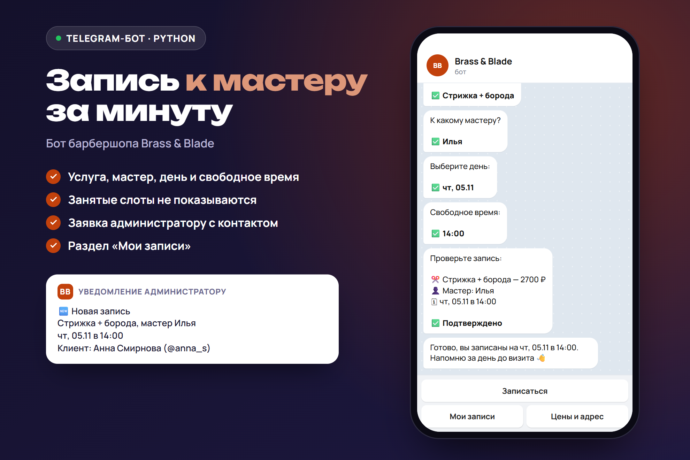
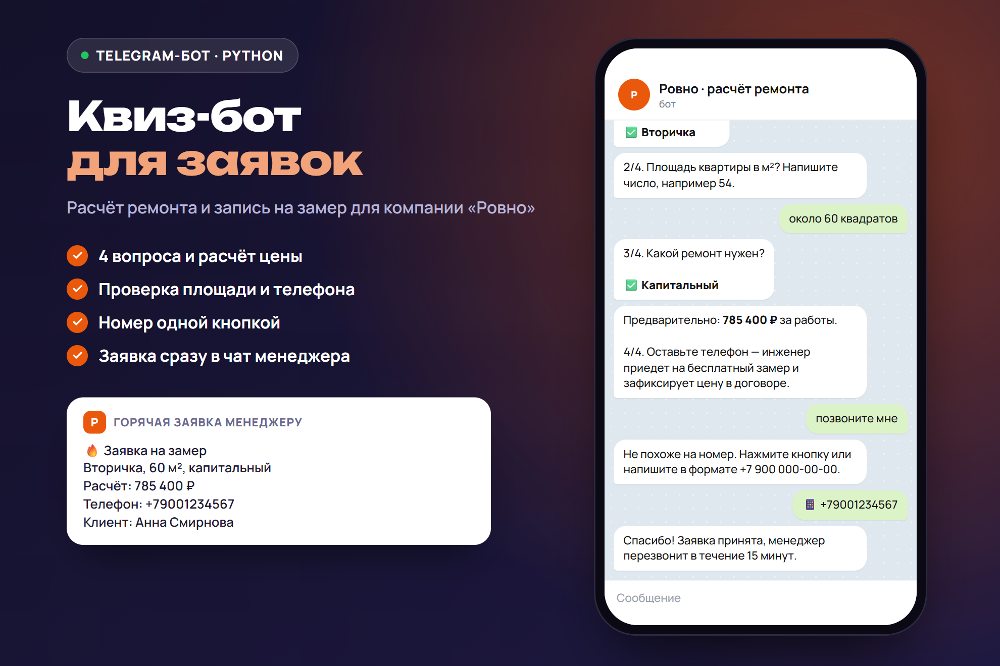
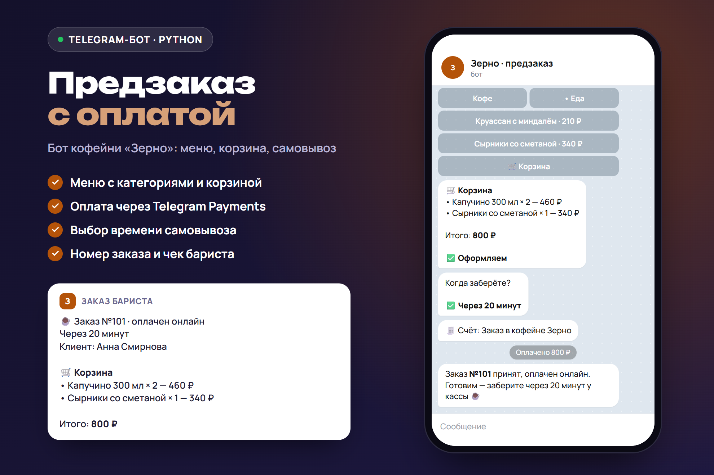
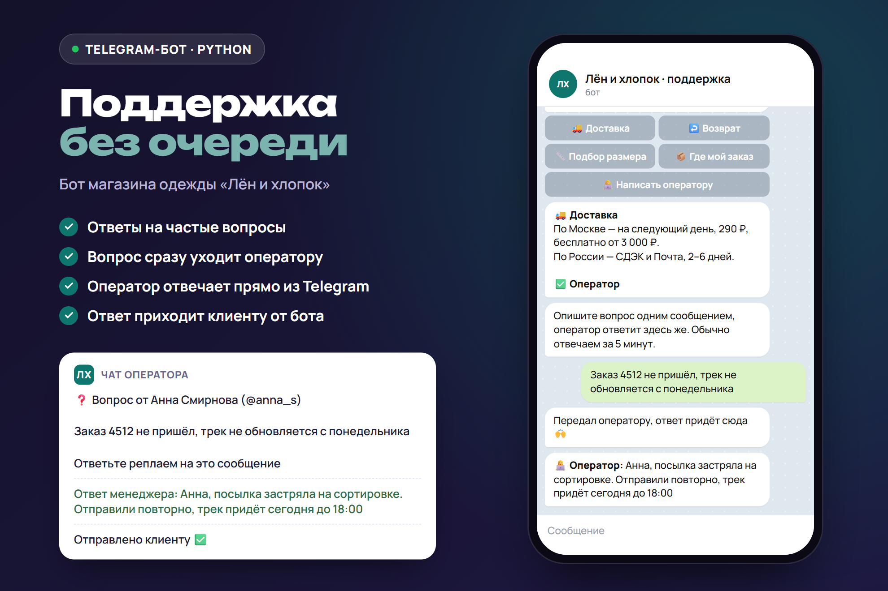
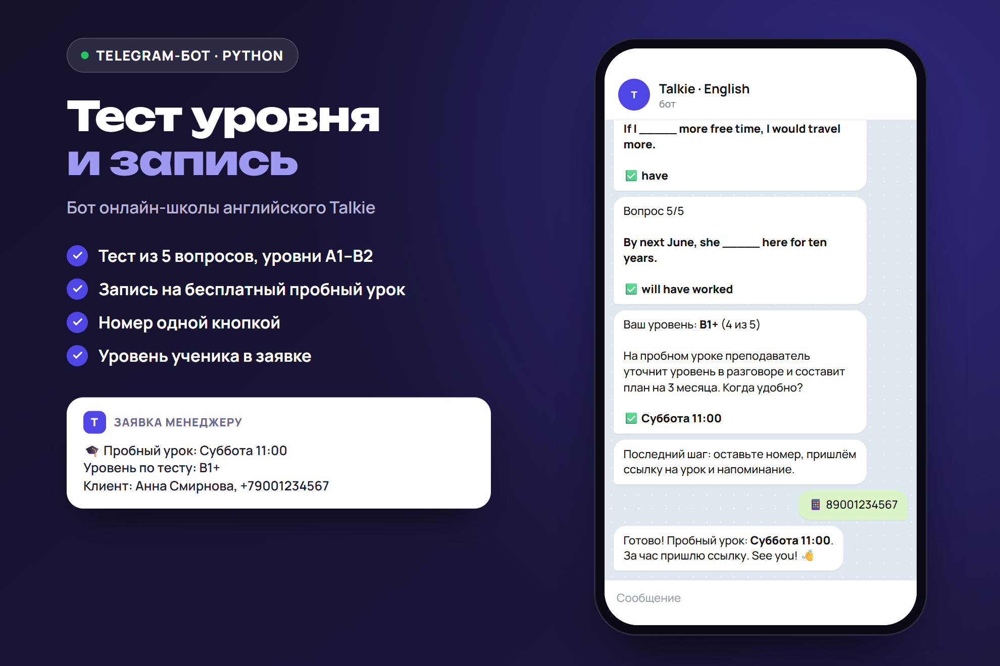

# Telegram-боты для бизнеса

Пять готовых ботов на Python для типовых задач малого бизнеса: запись, заявки, заказы с оплатой, поддержка и онлайн-школа. Каждый бот — один файл, общий код в `bots/common.py`.

| Бот | Что делает |
|---|---|
| [`booking`](bots/booking.py) | Запись в барбершоп: услуга → мастер → день → свободное время. Занятые слоты не показываются, администратор получает уведомление, у клиента есть «Мои записи» |
| [`leads`](bots/leads.py) | Квиз для заявок на ремонт: 4 вопроса, проверка площади и телефона, расчёт цены, горячая заявка менеджеру |
| [`shop`](bots/shop.py) | Предзаказ в кофейне: меню с категориями, корзина, время самовывоза, оплата через Telegram Payments или при получении |
| [`support`](bots/support.py) | Поддержка магазина: ответы на частые вопросы, переписка с оператором — оператор отвечает реплаем, клиент получает ответ от бота |
| [`school`](bots/school.py) | Онлайн-школа английского: тест уровня из 5 вопросов, запись на пробный урок, заявка с уровнем менеджеру |



<details>
<summary>Остальные боты</summary>






</details>

## Запуск

```bash
python -m venv .venv
.venv/Scripts/pip install -r requirements.txt   # Linux/macOS: .venv/bin/pip
```

Создайте бота у @BotFather, затем:

```bash
BOT_TOKEN=123:ABC ADMIN_ID=ваш_telegram_id python -m bots.booking
```

`ADMIN_ID` — чат, куда приходят заявки (узнать свой id можно у @userinfobot). Для оплаты в `shop` добавьте `PAYMENT_TOKEN` от платёжного провайдера (ЮKassa и др.), без него заказ оформляется с оплатой при получении.

## Проверка без Telegram

```bash
python -m tests.simulate
```

Скрипт подменяет сетевую сессию aiogram, проходит сценарий каждого бота как живой пользователь (команды, кнопки, контакт, оплата, ответ оператора) и проверяет ответы. Переписка сохраняется в `transcripts/`, а `node render/render.cjs` рисует по ней картинки из `docs/` — на скриншотах ровно то, что отвечает код.

## Стек

Python 3.12, aiogram 3 (FSM, инлайн- и reply-клавиатуры, Telegram Payments). Хранилище в памяти — для продакшена подключается SQLite, Redis или Google Таблицы.

Компании в примерах вымышленные.
